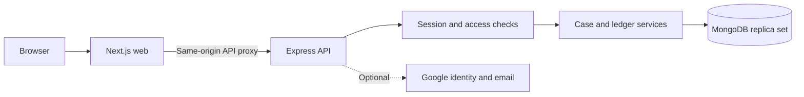

<div align="center">


# CollectDesk

**A role-based commercial collections workspace**

Case intake, review, team operations and verified recovery reporting — built around a transactional ledger.

[Live application](https://collectdesk.onrender.com/) · [Sign in](https://collectdesk.onrender.com/login) · [Architecture](docs/ARCHITECTURE.md) · [Setup](docs/DEVELOPMENT.md)

[](https://github.com/Syed-Nazeer-07/CollectDesk/actions/workflows/ci.yml)

Next.js 16 · React 19 · TypeScript · Express 5 · MongoDB

</div>

> **Portfolio and technical evaluation only.** Use fictional records. CollectDesk does not process payments or contact debtors. Do not upload real invoices, identities or financial information. The free hosted preview may take time to wake.

## Product

CollectDesk centralizes the workflow for an overdue fictional invoice, from creditor submission to administrator review and operator follow-up. Verified receipts and reversals determine recovery totals; closing a case does not imply full repayment.

| Workspace | Responsibilities |
| --- | --- |
| Creditor | Create and restore drafts, submit overdue invoices, respond to review requests, track shared activity and export company cases. |
| Administrator | Review cases, assign operators, verify or reject sample receipts, reconcile ledger entries, manage staff and support. |
| Operator | Work assigned cases, schedule internal follow-ups, and record shared or private case updates. |

### Key features

- Responsive dashboard, case register, modal intake, and light/dark/system appearance.
- Server-side case search, filtering, sorting, pagination and scoped CSV exports.
- Integer-paise accounting, transaction-backed mutations, audit history and receipt reversals.
- Role- and organization-scoped access, revocable sessions, and optional identity/email providers.
- Recovery reports, follow-up queues, notification history, and operational health views.

## Architecture



The API enforces authorization independently of the UI. Case and receipt mutations commit with their audit records inside MongoDB transactions. Standalone MongoDB is deliberately unsupported.

Read the [architecture and data model](docs/ARCHITECTURE.md) for transaction boundaries, permission rules and limitations.

## Run locally

Use Docker Desktop with Linux containers. For host-side development and testing, use Node.js 22.23.4 (see [`.nvmrc`](.nvmrc)).

```bash
git clone https://github.com/Syed-Nazeer-07/CollectDesk.git
cd CollectDesk
cp .env.compose.example .env.compose
```

Windows PowerShell: `Copy-Item .env.compose.example .env.compose`.

Set your own `JWT_SECRET` (at least 32 characters) and `DEMO_SEED_PASSWORD` (at least 12 characters) in the private `.env.compose` file.

```bash
docker compose --env-file .env.compose build
docker compose --env-file .env.compose --profile seed run --rm seed
docker compose --env-file .env.compose up -d database api web
```

Open [localhost:3000](http://localhost:3000). The fictional fixture includes creditor, operator and administrator accounts; their password is the value you configured locally. See the [development guide](docs/DEVELOPMENT.md) for exact account names, native development, tests and hosting.

## Verification

Latest verified application revision at the time of this documentation update: [`2dccf35`](https://github.com/Syed-Nazeer-07/CollectDesk/commit/2dccf35ad72a77086781115c070a48562dadef46), deployed November 28, 2026.

| Check | Result |
| --- | --- |
| Unit and replica-set API integration tests | 63 passed, 0 failed |
| Responsive layout checks | 280 passed, 0 failed |
| Seeded browser workflows | Passed |
| Persistent workspace navigation | Passed |
| TypeScript, Next.js build and hosted container | Passed |

[CI evidence](https://github.com/Syed-Nazeer-07/CollectDesk/actions/runs/46095049069) · [Browser screenshot artifact](https://github.com/Syed-Nazeer-07/CollectDesk/actions/runs/46095049069/artifacts/15243076562) (GitHub artifacts expire) · [Live release metadata](https://collectdesk.onrender.com/api/v1/meta/release)

For reproduction, scope and outstanding release gates, see [verification and limitations](docs/VERIFICATION.md). A passing CI run does not certify commercial or regulatory readiness.

## Repository

```text
apps/
  api/         Express API, models, authorization, ledger, tests
  web/         Next.js routes, components, themes
docs/          Architecture, development, verification, research
scripts/       Local launcher, smoke and browser audits
.github/       Continuous integration and live diagnostics
compose.yaml   Local replica-set demonstration
render.yaml    Hosted preview configuration
```

## Documentation

| Document | Purpose |
| --- | --- |
| [Architecture](docs/ARCHITECTURE.md) | System design, permissions, accounting and storage |
| [Development](docs/DEVELOPMENT.md) | Local setup, testing, configuration and deployment |
| [Verification](docs/VERIFICATION.md) | Test evidence, acceptance scope and known limitations |
| [Security](SECURITY.md) | Safe data handling and responsible reporting |
| [Research](docs/research/README.md) | Original product requirements and competitor research |

---

Built by [Syed Nazeer](https://github.com/Syed-Nazeer-07).
