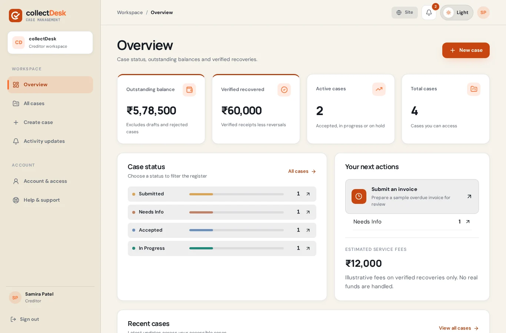

<div align="center">

# CollectDesk

**A role-based workspace for commercial collections**

Organize overdue cases, coordinate creditor and operations teams, and track verified *sample* recoveries in one place.

[Live demo](https://collectdesk.onrender.com/) · [Sign in](https://collectdesk.onrender.com/login) · [CI runs](https://github.com/Syed-Nazeer-07/CollectDesk/actions)

[](https://github.com/Syed-Nazeer-07/CollectDesk/actions/workflows/ci.yml)

Next.js 16 · React 19 · TypeScript · Express 5 · MongoDB

</div>

> [!IMPORTANT]
> **Public and seeded environments are fictional-data only.** CollectDesk manages creditor and operations workflows. Real customer onboarding requires independent security, business, and privacy approval. The public Render deployment may need a cold start.

## What it does

CollectDesk follows the lifecycle of an overdue *demonstration* case:

```text
Creditor drafts and submits a case
             ↓
Administrator reviews and assigns it
             ↓
Operator records case activity
             ↓
Administrator verifies sample receipts
             ↓
Case is reconciled or closed
```

| Capability | Details |
| --- | --- |
| Role-based access | Separate creditor, administrator and operator permissions |
| Case register | Server-side search, status filters, sorting, pagination and permission-scoped CSV export |
| Collections oversight | Sample balances, verified receipt totals, reversals and activity history |
| Organization isolation | Creditor records restricted to the appropriate organization |
| Organization access | Company profiles, owner-issued member invitations, role-based access and session revocation |
| Financial operations | Replica-set transactions, idempotent receipt mutations and reconciliation exports when configured |
| Team operations | Staff invitations, support requests and role-scoped notifications |
| Profile | Edit your own display name while signed in |
| Onboarding and identity | Company setup; optional Google sign-in, email verification and password recovery |
| Documents | Configurable private, scanned PDF storage with access audit and expiry. The public preview retains synthetic-only evidence. |

**Accounting behavior:** Pending receipts are not counted as recovered funds. A case marked closed does not necessarily mean its entire balance was paid. CSV exports are capped at 5,000 accessible rows and exclude internal notes and credentials.

## Screens from the local demo



[More screenshots in light and dark mode](docs/screenshots/README.md)

## Role permissions

| Role | Cases | Account and operations |
| --- | --- | --- |
| Creditor | Create, edit and export company cases. Submit overdue drafts, respond to review requests and view shared updates and verified receipts. | Manage own display name and support requests. |
| Administrator | Review, assign, hold and close cases. Record, verify, reject and reverse sample receipts. | Invite operators and manage the support queue. |
| Operator | Open assigned cases and post internal notes or creditor-visible progress. | Manage own display name and support requests. |

## Tech stack

- **Web:** Next.js, React, TypeScript and Lucide
- **API:** Node.js, Express, Zod, signed HTTP-only session cookies and bcrypt
- **Data:** MongoDB and Mongoose
- **Infrastructure:** Docker Compose for local demos; Render for the hosted preview
- **Checks:** Node.js tests, TypeScript checks, Playwright browser audit and GitHub Actions

Next.js serves the workspace and forwards same-origin API requests to Express. The API resolves signed session cookies against the current user record and applies company or assignment restrictions before loading case data. MongoDB stores cases, activity, receipt decisions and support history. The dashboard reads verified ledger totals and applies the same integer-paise fee calculation as case details.

## Repository layout

```text
CollectDesk/
├── apps/
│   ├── api/                  Express API, models and tests
│   └── web/                  Next.js pages, components and styles
├── docs/                     Requirements, research and QA notes
├── scripts/                  Smoke tests, browser audit and launch utilities
├── .github/workflows/        CI and external preview diagnostics
├── compose.yaml              Local MongoDB, API and web services
├── Dockerfile                Local Compose build
├── Dockerfile.render         Single-container hosted preview
├── render.yaml               Render Blueprint configuration
└── package.json              npm workspaces and project commands
```

## Quick start: local demo with Docker

**Prerequisites:** Docker Desktop (Linux containers) and Node.js/npm. Use only fictional data.

1. Clone the repository and enter its directory:

   ```bash
   git clone https://github.com/Syed-Nazeer-07/CollectDesk.git
   cd CollectDesk
   ```

2. Copy the environment template to a private file:

   ```bash
   cp .env.compose.example .env.compose
   ```

   On Windows PowerShell, use `Copy-Item .env.compose.example .env.compose` instead.

3. In `.env.compose`, set a unique `JWT_SECRET` (32+ characters) and `DEMO_SEED_PASSWORD` (12+ characters). **Do not commit this file.**

4. Build, seed fictional records and start the three services:

   ```bash
   docker compose --env-file .env.compose build
   docker compose --env-file .env.compose --profile seed run --rm seed
   docker compose --env-file .env.compose up -d database api web
   ```

Open [http://localhost:3000](http://localhost:3000). The local API listens at [http://localhost:4000](http://localhost:4000).

The seed script creates fictional reviewer accounts for the three roles. It uses your private `DEMO_SEED_PASSWORD`; no public password is included here.

To stop the services:

```bash
docker compose --env-file .env.compose down
```

### Development checks

Run these from the repository root after `npm ci` with a Node.js version supported by `package.json`:

```bash
npm run typecheck -w @collectdesk/web
npm test
npm run build
```

`npm run check` combines the API test suite and web build. `npm run smoke` and `npm run audit:browser` require a running, appropriately seeded test environment. **Never run the browser audit against a production database**: it creates and updates test records.

For isolated API integration coverage, point `TEST_MONGODB_URI` at a disposable MongoDB database named `collectdesk_integration_test` or `collectdesk_ci_test`. The integration harness clears that database before running. Install `npx playwright install chromium` for the browser checks. With the fictional stack running at `http://localhost:3000`, set the fixture’s `DEMO_SEED_PASSWORD` and run `npm run audit:browser` and `node scripts/audit-layout.mjs`. See the [acceptance report](docs/DEMO_ACCEPTANCE.md) for fixture options, command results, and live-provider requirements.

## Configuration and hosting

The hosted demo uses `Dockerfile.render` with `scripts/start-hosted.mjs` to run Express and Next.js together. Configure secrets in your hosting provider rather than the repository.

| Setting | Purpose |
| --- | --- |
| `MONGODB_URI` | MongoDB connection string |
| `JWT_SECRET` | Strong session signing secret |
| `WEB_ORIGIN` | Actual HTTPS origin of the hosted application |
| `DEMO_SEED_PASSWORD` | Required only when seeding fictional accounts |
| `GOOGLE_CLIENT_ID` | Optional Google identity provider |
| `PUBLIC_REGISTRATION_ENABLED` | Optional public creditor registration; requires a working verification sender |
| `SAMPLE_EVIDENCE_ENABLED` | Synthetic-only attachment capability; disabled by default |
| `SEPARATE_RECEIPT_APPROVAL` | Optional two-person receipt control; requires enough authorized administrators |

See [API environment examples](apps/api/.env.example), [web environment examples](apps/web/.env.example), and [Compose configuration](.env.compose.example) for additional options. Email delivery requires an approved Resend/Brevo sender or a supported SMTP environment; Render Free restricts outbound SMTP. Never expose secret keys in the frontend.

The [live diagnostic workflow](.github/workflows/live-preview.yml) checks public routes and authorization failures, but does **not** establish that real identity providers, email delivery or business acceptance have been tested.

## Documentation

- [Product requirements (PDF)](docs/Commercial_Collections_PRD_v0.1.pdf)
- [Competitor research (PDF)](docs/Commercial_Collections_Competitor_Research_Enhanced.pdf)
- [Production foundations, API reference and runbooks](docs/PRODUCTION_FOUNDATIONS.md)
- [Current demo acceptance and QA](docs/DEMO_ACCEPTANCE.md)
- [Feature completion matrix](docs/FEATURE_MATRIX.md)
- [Implementation checklist](docs/IMPLEMENTATION_CHECKLIST.md)
- [Engineering audit and known limitations](docs/COMPREHENSIVE_AUDIT_2026-11-12.md)
- [Release-readiness checklist](docs/RELEASE_READINESS.md)

## Limitations and release status

The application is being developed for real B2B operations. Customer onboarding and real document processing require independent review and an approved deployment. Consult the production foundations runbook for the technical and business release gates.

The GitHub Actions badge reflects automated checks on `main`, **not** compliance certification or live-provider readiness. See the release-readiness checklist for what is still unverified.

---

<div align="center">

Built by [Syed Nazeer](https://github.com/Syed-Nazeer-07) · © 2026 CollectDesk

</div>
