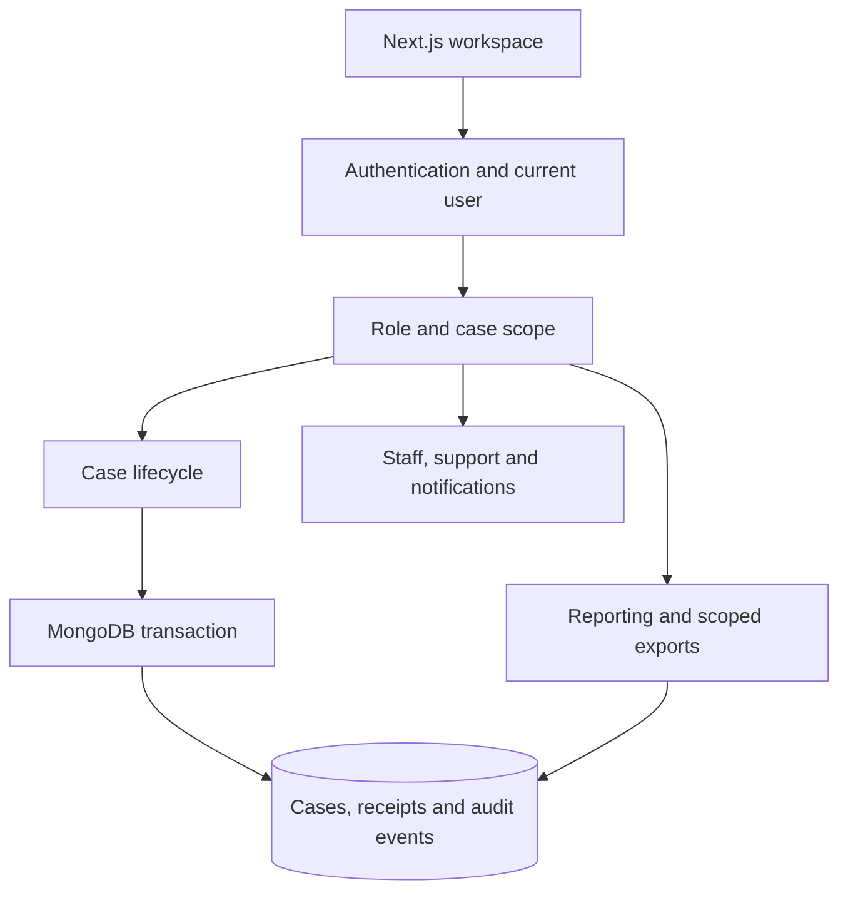

# Architecture

CollectDesk is a fictional-data technical evaluation of commercial case operations. The active system is the source on `main`; historical prototypes and branches are not part of the deployed feature set.

## System boundaries

- **Web:** Next.js App Router, React, TypeScript and Lucide. A persistent session provider avoids repeated loading during navigation. Shared theme tokens support light, dark and system preferences.
- **API:** Express, Zod, Mongoose, bcryptjs, signed HTTP-only sessions and explicit server-side authorization.
- **Database:** MongoDB replica set or sharded deployment. Transaction topology is checked at startup.
- **Deployment:** Next.js forwards same-origin API requests to Express. Local Docker Compose runs separate services; Render runs both processes in one container with Express bound to loopback.

## Authorization model

| Role | Scope |
| --- | --- |
| Creditor | Own organization; shared case history and verified receipts |
| Operator | Currently assigned cases; internal follow-ups and permitted notes |
| Administrator | Global operational oversight in the demo |

The API resolves current user records, session versions and revocation state for protected requests. Scope is enforced on reads and mutations; interface visibility is not the security boundary. Public registration creates creditor accounts only. Administrator access is global by design, not a per-tenant administrator model.

## Case and financial integrity

Drafts can be submitted after an invoice is overdue, reviewed, accepted and assigned. The lifecycle includes information requests, rejection, active work, hold and closure. Pending receipts do not change recovered totals. Verified receipts contribute to net recovery, and verified reversals correct it. Values use integer paise with checked arithmetic; financial rules reject invalid amounts and over-recovery.

Case creation, edits, submission, reviews, assignments, status transitions, notes, follow-ups and receipt decisions use transactions with audit records. The case revision provides a serialization point for conflicting mutations. API success follows commit. Receipt recording supports safe retries using its case/reference identity; conflicting repeats fail. This is not general-purpose idempotency for every mutation.

Reconciliation is read-only: it compares ledger, reversal and audit relationships and flags missing or legacy metadata without fabricating history. Optional separate receipt approval requires a different administrator to verify a recorded receipt. Closing a case does not imply that the entire principal was recovered.

Relevant code: [ledger](../apps/api/src/ledger.js), [rules](../apps/api/src/rules.js), [models](../apps/api/src/models.js), [API](../apps/api/src/app.js).

## Operational views

Recovery reports aggregate verified movements by verification date in India business time. Reports expose gross receipts, reversals and signed net amounts for up to 366 days. Legacy entries without verification dates are excluded. CSV exports are scoped; case exports are capped at 5,000 accessible rows. Current operator assignments are not historical individual-performance measures.

The staff queue holds one internal next action per active case, with revision guards and audited updates. Closing a case clears its current next action. Notifications reflect the authorized audit trail and persist read state. No external reminders or debtor outreach are sent.

Administrator health metrics are bounded and process-local, not a production observability system.

## Synthetic evidence

Optional synthetic-only PDF uploads are disabled by default. The current feature limits PDFs to 1 MiB and three attachments per case. New BSON-backed files and their audit mutations use transactions. Legacy GridFS files remain supported through a separate path; legacy deletion is not atomic. PDF format checks are not malware screening.

## Design limitations

Do not use actual debtor or financial information. The project does not implement payment processing, regulated collection operations, real document scanning and retention, or enterprise tenant administration. See [verification](VERIFICATION.md) for outstanding release gates and [security](../SECURITY.md) for responsible handling.
